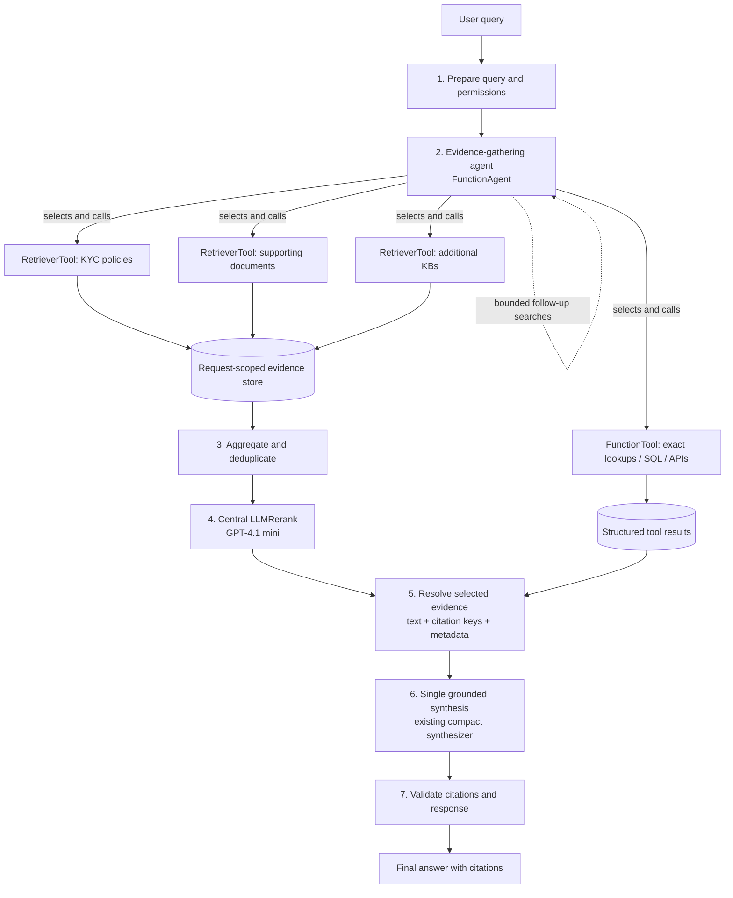

# Multi-Knowledge-Base Agentic RAG — Architecture Handoff

## Goal

Evolve the existing **LlamaIndex single-context RAG** into a **multi-knowledge-base, tool-using RAG workflow**. An LLM-based evidence-gathering agent should decide which knowledge bases and business tools to use, while retrieval, evidence handling, reranking, and final answer synthesis remain explicitly controlled by an outer workflow.

**This is an architecture handoff, not a prescriptive refactor of the repository.** Inspect the current code, reuse existing components where possible, and adapt the implementation to the installed LlamaIndex version and internal model integrations.

## Target architecture



**Ownership:** The outer `Workflow` owns execution and evidence state. The **only agent** is the evidence-gathering `FunctionAgent`. The answer synthesizer is an LLM-powered step, **not** a second agent.

## Workflow stages

### 1. Query preparation
- Accept the user query and relevant conversation context.
- Resolve the authenticated user's authorized KBs and tool permissions before agent execution.
- Establish a request ID, per-request state, timeout, and tool-call budget.
- Do not let a tool become accessible merely because the LLM asks for it.

### 2. Evidence gathering (one agent)
- Use LlamaIndex `FunctionAgent` with clear descriptions for each available tool.
- Let it choose **one or several KBs**, reformulate search queries, call custom tools, and optionally perform a bounded second search when coverage is insufficient.
- Prefer **`RetrieverTool`** for KBs that expose a standard LlamaIndex retriever; use **`FunctionTool`** for exact descope lookups, SQL, APIs, or retrieval needing truly custom arguments/logic.
- Each KB initially retrieves approximately **top 10** candidates (configurable). Where supported, prefer hybrid dense + keyword search, especially for codes and document titles. Apply authorization and metadata filters in the underlying retriever.
- Crucially, **capture original `NodeWithScore` objects from tool execution**, e.g. underlying `ToolOutput.raw_output` when supported; do not reconstruct evidence from the agent's final text. The agent may see bounded summaries/IDs, while the full evidence stays in request-scoped state.
- Verify how agent tool-call outputs are surfaced in the installed LlamaIndex version (for example, tool-call result events or a controlled execution wrapper). Avoid mutable shared global collectors that could mix concurrent users.

### 3. Deterministic evidence aggregation
- Collect all retrieved candidates across all agent searches and KBs.
- Normalize KB ID, document ID, chunk/node ID, original text, version/link, and retrieval rank/score.
- Deduplicate by stable **KB + document + chunk identity**, with an explicit policy for duplicate documents indexed in more than one KB.
- Keep scores/ranks as metadata; **do not directly compare raw similarity scores from unlike vector stores**.
- Optionally interleave candidates across KBs before reranking. Apply candidate-count and token-size limits without silently eliminating required sources.
- **Aggregation is not another LLM step.** It outputs the combined evidence objects, not merely citation keys.

### 4. Centralized reranking
- Start with LlamaIndex **`LLMRerank`** using internally approved **GPT-4.1 mini**. Initial parameters: `top_n=8`, `choice_batch_size=10`; treat both as configurable and tune via tests.
- Rerank the **aggregated, deduplicated `NodeWithScore[]`** against the user's information need. Keep the original nodes and their source metadata intact.
- Be aware: batches are evaluated separately; cross-batch scores may not be perfectly comparable. Interleave KB candidates and measure whether relevant sources are being dropped.
- Put reranking behind a replaceable interface so it can be disabled or exchanged for deterministic selection / an approved dedicated reranker.
- If reranking fails, use an explicit bounded fallback (e.g. rank-based interleaving with source coverage), and record that fallback in telemetry.

### 5. Evidence resolution + structured data
- Map the selected nodes to **stable citation keys**, full original content, and source metadata. Store the full mapping in workflow state.
- **Synthesis must receive the selected evidence text *and* citation keys. Citation keys alone are insufficient.**
- Keep authoritative exact-match results (such as a requested descope guideline row) separate from semantic reranking and include them when relevant. Preserve provenance for these results as well.
- If the selected context cannot support an answer, prefer a controlled additional retrieval pass or an explicit insufficient-evidence answer rather than invented content.

### 6. Single answer synthesis
- Reuse the existing LlamaIndex **`compact` response synthesizer** where practical (currently GPT-4.1 in the proposed setup).
- Supply the question, selected evidence content, citation identifiers, and any relevant structured tool results.
- Generate **one final answer** across all KBs. Do not have each KB synthesize its own answer first (`QueryEngineTool` is not the default for KB search here).
- Instruct synthesis to use only supplied evidence for factual claims, attribute statements to sources, and report uncertainty or conflicts.

### 7. Response validation
- Check that cited keys resolve to evidence actually available to synthesis and that the output follows the application's response contract.
- Preserve source titles, SharePoint/document links, and document versions when available.
- Note that checking citation keys is **not** proof that a claim is semantically supported; evaluate factual grounding separately.
- Return a safe insufficient-evidence response on empty retrieval or unrecoverable failures.

## Proposed data contracts (conceptual)

```text
RetrievalEvidence
  citation_key?       # stable request-local key, finalized before synthesis
  kb_id
  document_id
  chunk_id / node_id
  text
  source_title / source_url / version
  retrieval_rank / retrieval_score
  original_node       # NodeWithScore, retained in workflow state

StructuredToolResult
  tool_name
  result_data          # e.g. exact descope row
  source/provenance

WorkflowState
  request_id / query / permissions
  tool_calls_and_status
  evidence_by_id       # complete, request-isolated evidence objects
  structured_results
  selected_evidence
  citation_map
```

Choose the lightest data model compatible with the existing code. Avoid serializing the full raw node object into an LLM prompt or storing sensitive tool data in general application logs.

## Tool choices

| Tool type | Use for | Expected behavior |
|---|---|---|
| `RetrieverTool` | Plain retrieval from a specific vector store / KB | Returns KB top-K candidates; retain raw `NodeWithScore` results |
| `FunctionTool` | Exact descope lookup, SQL, API calls, custom business operations | Typed, validated parameters; return structured output and provenance |
| `QueryEngineTool` | A KB that genuinely needs to answer autonomously | **Not** the default: per-KB answer synthesis weakens centralized evidence control |

For custom permissions, filters, or hybrid retrieval, prefer implementing a suitable underlying **custom `BaseRetriever` + `RetrieverTool`** where feasible rather than reflexively wrapping all KBs in `FunctionTool`.

## Configuration defaults to evaluate

- Retrieval: `top_k=10` per selected KB; hybrid retrieval if supported.
- Reranker: `LLMRerank(llm=GPT-4.1-mini, top_n=8, choice_batch_size=10)`.
- Synthesis: existing GPT-4.1 + `compact` path.
- Agent: bounded iterations, tool calls, retrieval retries, concurrency, and total latency.
- Preserve required exact-match rows even if semantic evidence selection yields a different top N.

These are **starting points, not claims of optimal settings**.

## Suggested implementation sequence

1. Inspect the existing single-KB retrieval, synthesis, citation, and authentication code. Preserve the current behavior as a regression baseline.
2. Extract each KB into its own retriever and register `RetrieverTool` instances with meaningful, non-overlapping descriptions.
3. Add the outer LlamaIndex `Workflow` and evidence-gathering `FunctionAgent`; explicitly capture original tool evidence in request-scoped workflow state.
4. Implement deterministic aggregation/deduplication and centralized `LLMRerank` with a fallback strategy.
5. Feed reranked nodes plus applicable structured business results to the existing compact synthesizer; retain citation mapping through the final answer.
6. Add tests, traces, and evaluation; compare the new system with the existing RAG pipeline before replacing it.

## Acceptance criteria / tests

- A single-KB question searches the appropriate KB and produces a cited answer.
- A multi-KB question can call more than one retrieval tool, combine evidence, and cite sources from both.
- An exact descope-code question returns the authoritative structured result without relying on embedding similarity.
- Repeated tool calls do not duplicate evidence or mix results between concurrent users.
- No unauthorized KB or source can be retrieved or included in a response.
- The reranker receives original evidence text and the synthesizer receives the **selected original evidence + citation keys**, never keys alone.
- Citations resolve to actual selected sources; zero-result and tool-failure paths are handled gracefully.
- Compare routing recall, evidence recall@K, citation accuracy, answer faithfulness, latency, cost, and repeat-query consistency against the current baseline.

## Non-goals for this first iteration

- Multiple collaborating agents or agent handoffs.
- An independent synthesizer agent.
- Autonomous data-changing tools or unapproved side effects.
- A completely new ingestion pipeline, vector database, or embedding strategy unless tests show they are necessary.

## Notes for the coding agent

This design is intentionally **repository-agnostic**. Before implementing, inspect installed LlamaIndex APIs and existing interfaces, especially `RetrieverTool` raw outputs, `FunctionAgent` tool-result events, workflow `Context` handling, `LLMRerank`, and the existing response synthesizer. Prefer small, testable changes and reuse established internal abstractions. Flag incompatible APIs or integration constraints rather than building speculative replacement infrastructure.

### LlamaIndex references

- [Workflows](https://docs.llamaindex.ai/en/stable/understanding/workflows/)
- [Agents as tools / tool-call events](https://docs.llamaindex.ai/en/latest/examples/agent/agents_as_tools/)
- [RouterRetriever](https://docs.llamaindex.ai/en/stable/api_reference/retrievers/router/)
- [Node postprocessors and LLM reranking](https://docs.llamaindex.ai/en/stable/module_guides/querying/node_postprocessors/)
